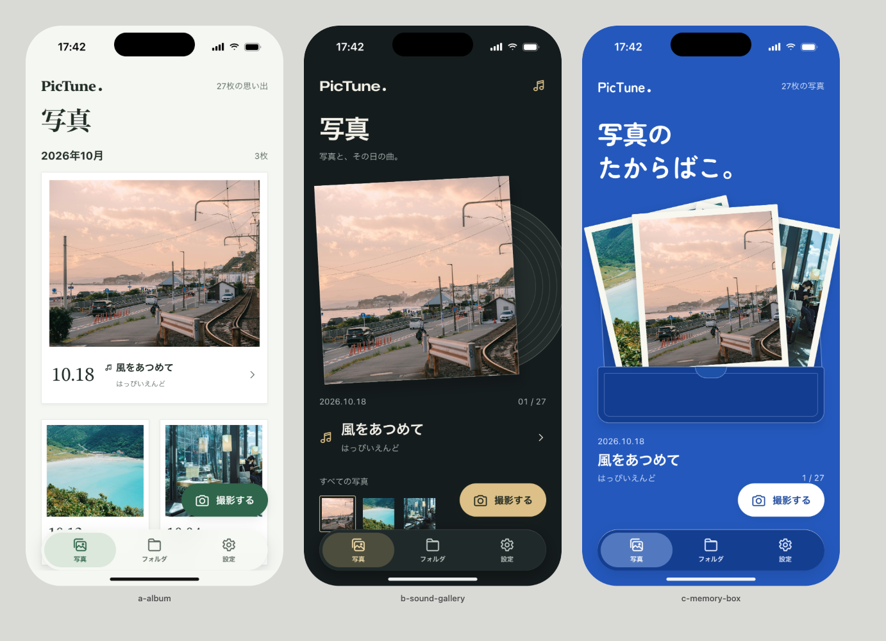

# PicTune メイン画面3案

2026年10月19日。「方向を絞らず比較する」という指定で、同じ写真・日付・曲を使った3方向を制作しました。採用案は未決定です。



| 案 | 主役・見た目 | 強み | 比較上の弱み |
|---|---|---|---|
| A 日々のアルバム | 明るい背景、明朝、白いチェキ | 写真と日付をたどりやすい | 音楽の印象・造形の意外性は控えめ |
| B 音のギャラリー | 暗い背景、太い文字、レコードの溝 | 写真と音楽の組み合わせが明快 | 同時に比較できる写真が少ない |
| C 思い出のたからばこ | 青い背景、丸文字、写真の束と箱 | 写真を取り出す楽しさと固有性 | 写真を素早く探す効率はAに劣る |

各案は背景・書体・豊かさの源・色の系統が異なります。名前、撮影、写真・フォルダ・設定の3タブを維持し、曲名と日付を一覧で見せています。構想は写真タップから写真と曲を取り出す遷移です。実装前の比較資料で、アプリの画面は差し替えていません。

## 開き方・成果物

- [3案のHTML](explore.html)：ローカルのブラウザで開き、写真を押すと拡大表示の試作を確認できます。撮影・タブは外観のみです。
- [現状との比較](before-after.html)：現行画面と3案を並べます。
- [現状との比較画像](shots/before-after.png)
- [仕様・保持機能・判断の根拠](DIRECTION.md)
- [2回の評価と確認結果](CRITIQUE.md)
- [写真・フォントの出典](assets/SOURCES.md)
- 通常サイズの個別画像：[A](shots/r2/01-a-album.png) / [B](shots/r2/02-b-sound-gallery.png) / [C](shots/r2/03-c-memory-box.png)
- [小さい画面の比較](shots/r2-small/sheet.png)

表示対象は402×874ptのiPhone相当と375×667ptの小型画面相当です。Chrome/macOS上で3x描画し、画像を個別に確認しています。iOS実機・シミュレーターのスクリーンショットではありません。システムフォント参照はmacOS向けです。

## 確認結果

2回の描画・別担当批評で、Bの重なり順、Cの日付、小型画面の撮影ボタン、Aの上部余白とホーム領域を改善しました。評価は46→49/60、Fidelityは3→4/5。最終6画面の自動スキャンはFAIL0・WARN0です。
写真拡大、正しい日付と曲、音楽なし、閉じる、Escape、Reduced Motionを確認し、ページエラーは0でした。

写真と曲の対応は架空のサンプルです。写真の出典は同梱しています。生成画像は使用していません。ムードと参照物は制作側で補完しました。実機の触覚・遷移、装飾済みチェキ、Dynamic Type、データ接続、反対のカラーモードは未確認です。アプリソースを変更していないため、Xcodeビルド・アプリテストは実行していません。

## 再描画

app-designerスキルとplaywright-core、Chromeがある環境の場合：

```sh
node ~/.codex/skills/app-designer/scripts/shoot.mjs docs/design/main-screen-exploration/explore.html --out /tmp/pictune-normal
node ~/.codex/skills/app-designer/scripts/shoot.mjs docs/design/main-screen-exploration/explore.html --out /tmp/pictune-small --width 375 --height 667
```

kitは同梱しています。グローバルのスキル参照が利用できない場合も、相対パスのkitで表示できます。各shotsフォルダにスキャン結果JSONを残しています。
