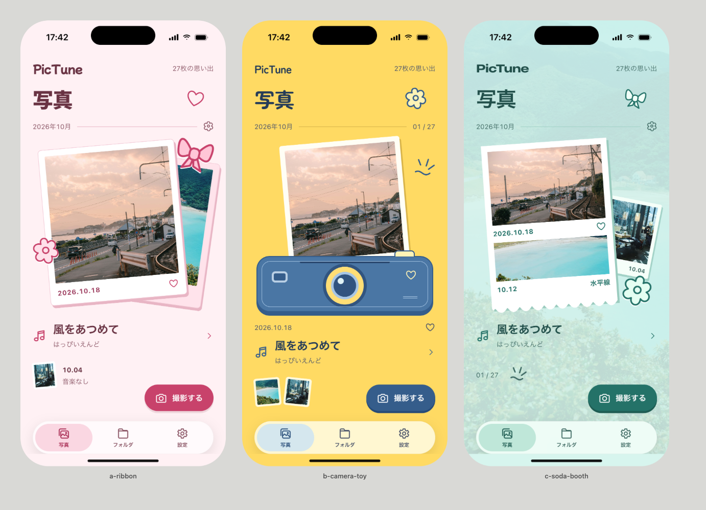

# PicTune メイン画面3案 · ポップ＆キュート版

2026年10月19日。「もっとポップで可愛いのが良い」という指定を受け、明るい色、丸い文字、リボンや花、紙とトイカメラの造形で3案を作り直しました。採用案は未決定です。



| 案 | 表現 | 比較上の特徴 |
|---|---|---|
| A リボンチェキ | ピンクの紙・太く丸い見出し・リボン | 最も甘め。既存のチェキやスタンプに近い可愛さです。 |
| B カメラトイ | レモン色・丸文字・青いトイカメラ | 最も元気でポップ。カメラから写真が出る楽しさを表します。 |
| C ソーダブース | ミントの景色・白い紙・丸い切り口 | すっきりした可愛さ。写真ごとの日付と曲を並べます。 |

名前、写真と曲、撮影、写真・フォルダ・設定の3タブを維持しています。アプリの画面を差し替える前の比較資料です。

## 成果物

- [3案のHTML](explore.html)：写真を押すと拡大表示を確認できます。撮影とタブは外観のみです。
- 個別画像：[A](shots/pop-r2/01-a-ribbon.png) / [B](shots/pop-r2/02-b-camera-toy.png) / [C](shots/pop-r2/03-c-soda-booth.png)
- [小型画面の比較](shots/pop-r2-small/sheet.png)
- [現状との比較HTML](before-after.html) / [比較画像](shots/before-after.png)
- [今回の仕様と判断](POP-DIRECTION.md) / [今回の批評と確認](POP-CRITIQUE.md)
- [素材の出典](assets/SOURCES.md)
- 初稿の記録：[HTML](explore-original.html) / [仕様](DIRECTION.md) / [批評](CRITIQUE.md)

## 確認範囲

Chrome/macOSで402×874pt・375×667ptを3x描画し、各画面を個別に目視確認しました。同じ批評担当による2回の評価は46→48/60、Fidelityは3→4/5。最終6画面の自動スキャンはFAIL0・WARN0です。

花が日付を隠す箇所、複数写真の日付の対応、小型カメラの大きさ、背景の濃さを修正しました。操作の確認結果は `shots/pop-interaction/verification.json` に保存しています。

実装前のHTMLモックアップで、iOSアプリのシミュレーター画像ではありません。アプリソースは変更していないためXcodeビルド・アプリテストは対象外です。実機の操作・触覚、指に追従する遷移、Dynamic Type、横画面、装飾済みチェキ、多数の実データ、ダークモード、macOS以外のフォント置換は未確認です。撮影・タブ先・音楽再生・Firebase・QR・NFCはHTMLに接続していません。写真と曲の対応は架空のサンプルです。

生成画像・有料クレジットは使っていません。色とモチーフの具体化は制作側で補完しています。

## 再描画

app-designerスキルとplaywright-core、Chromeがある環境の場合：

```sh
node ~/.codex/skills/app-designer/scripts/shoot.mjs docs/design/main-screen-exploration/explore.html --out /tmp/pictune-pop-normal
node ~/.codex/skills/app-designer/scripts/shoot.mjs docs/design/main-screen-exploration/explore.html --out /tmp/pictune-pop-small --width 375 --height 667
```
