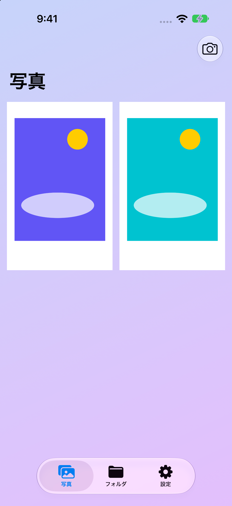
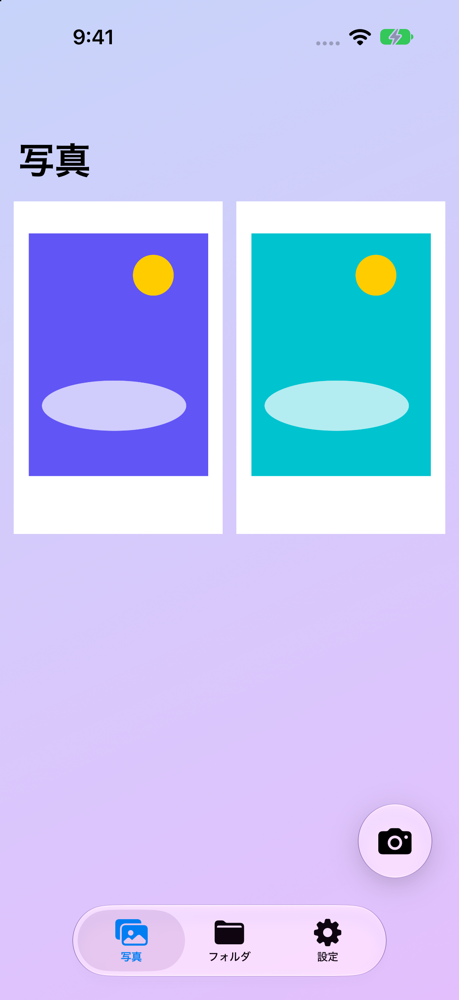
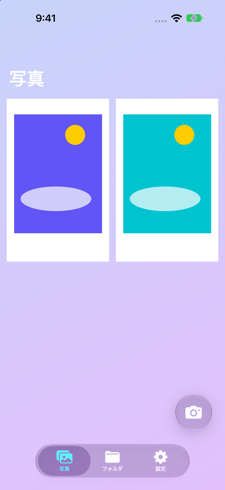
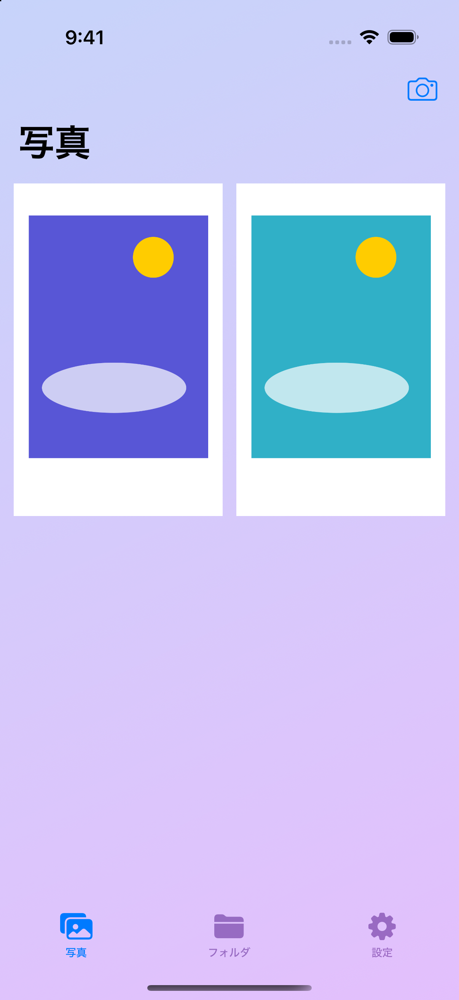
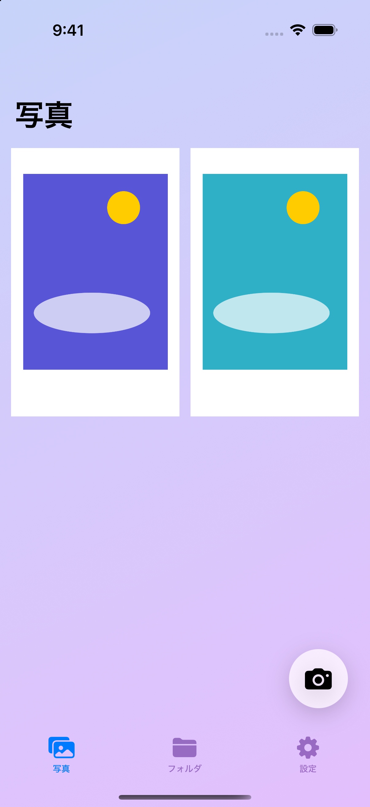
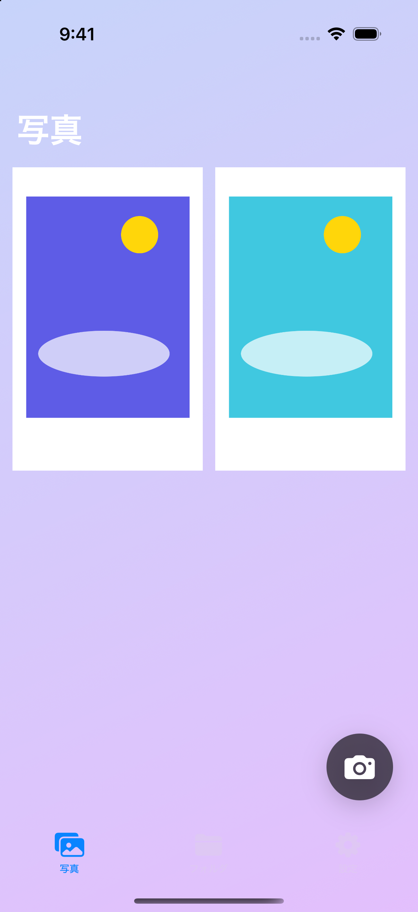

# 撮影ボタンの配置比較

写真一覧の右上にある撮影ボタンを、右下のフローティングボタンへ移した検討用の実装です。2026年10月19日に iPhone 18 Pro / iOS 27.0 と iPhone 16 Pro / iOS 18.5 のシミュレーターで撮影しました。写真は既存の `-ui-testing` によるローカルのサンプルデータです。

## iOS 27 / Liquid Glassの比較

同じ専用端末、ライト表示、サンプル写真2枚で比較しています。右上版は変更前の標準ツールバー、右下版はこのPRの実装です。右上版の撮影に一時的に使用したソースは元に戻しており、アプリのコードには追加変更を加えていません。

| 標準ツールバー右上 | 右下フローティング |
| --- | --- |
|  |  |

- 右上の標準ツールバーボタンにも、システムのLiquid Glassが自動適用されました。
- 右下ボタンとタブバーが、それぞれ独立したLiquid Glassの面として表示されました。
- 右下版はダーク表示でも背景とアイコンが切り替わりました。
- 右上比較版の通常署名付きDebugビルドも成功しました。追加確認は起動と表示の確認で、iOS 27でのUIテストは実行していません。

## HIGを踏まえた判断

この写真一覧では、右上の標準ツールバー配置が自然だと判断します。HIGは標準コンポーネントの利用と、操作を機能ごとに整理することを勧めています。右上なら撮影操作が写真に重ならず、下側のタブによる画面切り替えからも離せます。右下版は撮影を目立たせる一方、iOS 27の浮いたタブバーと近く、下側に操作が集まる見え方です。これはこの画面への設計判断であり、HIGが右下配置を禁止しているという意味ではありません。

参照：[Apple HIG — Toolbars](https://developer.apple.com/design/human-interface-guidelines/toolbars)、[Tab bars](https://developer.apple.com/design/human-interface-guidelines/tab-bars)。

## iOS 18.5の比較

| 変更前：ナビゲーション右上 | 変更後：右下フローティング |
| --- | --- |
|  |  |

## 変更内容

- 64ptの円形ボタンを、写真一覧の右端とタブバー上端から24pt離して固定しました。
- スクロール内容の末尾に104ptの余白を設け、最後の写真をボタンの上までスクロールできるようにしました。
- iOS 26以降はLiquid Glass、それ以前は標準の半透明マテリアルを使います。アイコンと背景はシステムの表示モードに追従します。
- 撮影ボタンのアクセシビリティ名、TipKit、コード交換の確認と各画面への遷移処理を引き継いでいます。

## 確認結果（iOS 18.5）

- `PIcTune.xcodeproj` / `PIcTune` の通常の署名付きDebugビルドが成功しました。
- 右下の「撮影」を押すとコード交換の確認が開き、「しない」で撮影画面へ遷移して一覧へ戻れることを確認しました。
- iOS 18.5で既存のUIテスト `sotsugyoUITests/testLibraryAndPhotoDetails` が成功しました。写真一覧から音楽あり・なしの詳細を開き、日付・楽曲・共有ボタンを確認しています。
- ライト・ダーク両方で撮影ボタンが表示され、アイコンと背景が切り替わることを確認しました。

## 未確認事項

実機での片手操作、実際の写真撮影・保存、QRコード交換は未確認です。

多数の写真での末尾スクロール確認は、シミュレーターのUI操作接続がタイムアウトし、完了できませんでした。確認用に一時的に変更したサンプル枚数は元に戻しており、PRには含めていません。
