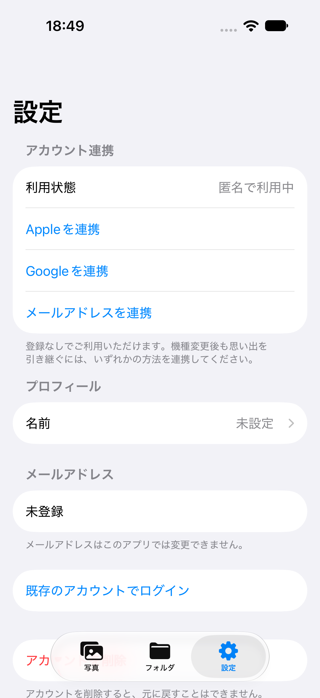
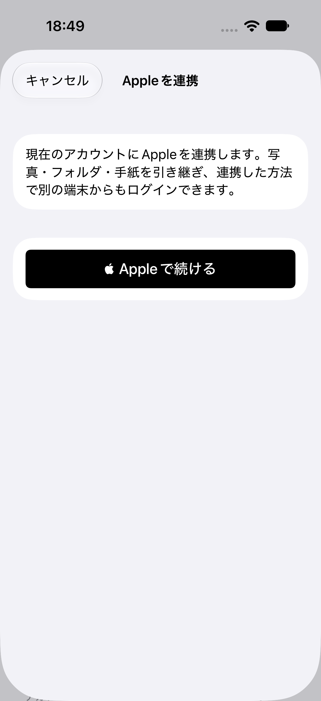
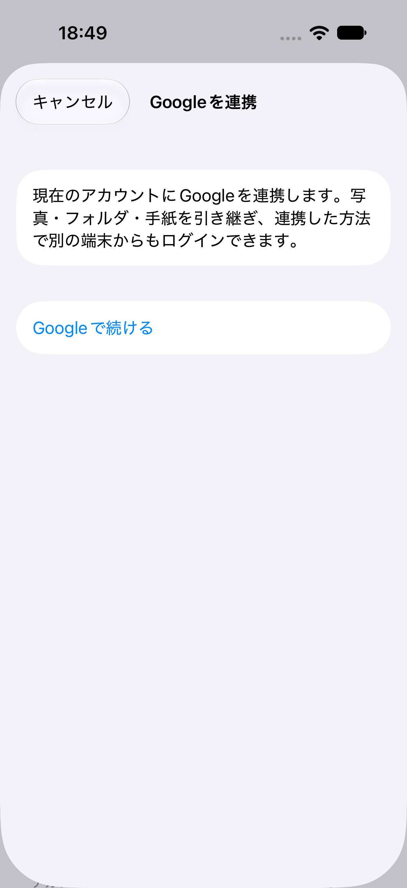
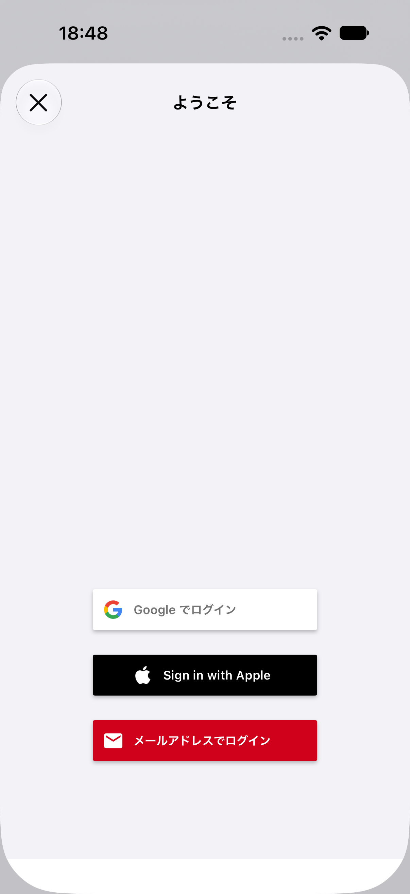

# 匿名ログインとアカウント連携

確認日: 2026-10-11（日本時間）

## 実装

- Firebase が保存済みの認証状態を復元した後、ユーザーが存在しない初回起動だけ匿名ログインします。既存の匿名・Apple・Google・メールユーザーは、その UID を維持します。
- 設定から Apple、Google、メール/パスワードを `User.link(with:)` で現在のアカウントへ追加します。連携済みのユーザーも、未連携の認証方法を追加できます。
- Apple は毎回新しい暗号学的乱数の nonce と標準認証ボタンを使用します。Google のリダイレクトは、既存ログイン画面を一度も開いていない場合も処理します。
- 連携時に別の Firebase アカウントへログインする処理は行いません。登録済みアカウントとの衝突はエラーを表示し、現在の匿名アカウントを保持します。
- 「既存のアカウントでログイン」は明示的な切り替え操作です。匿名時の写真・手紙は自動移行されず、切り替え前に説明と確認を表示します。既存の FirebaseUI ログインを使用します。
- 匿名時はログアウトを表示しません。アカウント削除には対応しています。ログアウト・削除直後はログイン画面を表示し、「登録せずに始める」で匿名利用を再開できます。
- 連携後は空のメールアドレスを補完し、編集済みの名前・既存プロフィール・ライブラリの日付を保持します。

## 確認環境

- プロジェクト / スキーム: `PIcTune.xcodeproj` / `PIcTune`
- Xcode: 27.2 Beta 2
- シミュレーター: iPhone 18 Pro / iOS 27.0（端末名 `PicTune Auth Tests`）
- 通常の署名付きビルドを使用。`CODE_SIGNING_ALLOWED=NO` は使用していません。

## 確認済み

- 署名付きビルド成功。
- 単体・統合テスト29件成功。初回匿名作成、既存ユーザーの復元、UID維持、写真・曲情報・手紙・編集した名前の保持、メール再ログイン、認証方法の衝突、無効なメール・弱いパスワード、Appleキャンセル、セッション切り替え後の古い連携画面の拒否を確認。
- エミュレーター上で Apple / Google のテスト用認証情報を同じ UID に連携し、両方で同じアカウントへ再ログインできることを確認。実際の Apple / Google 認証サーバーへの接続確認ではありません。
- シミュレーターで匿名設定、Apple / Google 連携画面の表示とキャンセル、匿名からの既存ログイン画面表示、匿名アカウント削除と再開、既存の名前編集・ログアウト確認画面を確認。
- 本番 Firebase の一時アカウントで、REST API による匿名認証 → メール連携 → メール再ログインを確認。同じ UID と匿名時に保存した手紙へのアクセスが維持され、デプロイ済み Firestore ルールで読み書きできました。検証用文書2件とアカウントは削除済みです。

## Firebase 設定

- 対象プロジェクト `sotugyou-7ea16` の `signIn.anonymous.enabled` を `false` から `true` に変更しました。
- メール認証は既に有効でした。匿名アカウントの自動クリーンアップは無効です。
- 既存ユーザー、他の認証設定、Firestore / Storage ルールは変更していません。

## 再現方法

ローカルの認証・Firestoreエミュレーターを起動します。

```sh
firebase emulators:start --only auth,firestore --project demo-pictune-auth --config firebase/auth-emulators.json
```

`PIcTune` スキームの `AuthRegressionTests`、`AnonymousAuthIntegrationTests`、`sotsugyoTests` と、UIテストの `testAnonymous` で始まる3件を実行します。単体テストのホストは Debug でエミュレーターを使用します。統合テストはエミュレーター未起動時にはスキップします。

画面を手動確認する場合、Debugビルドに `-auth-emulator` を渡すとローカル環境を使用します。さらに `-auth-reset-session` を渡すとローカルのセッションをログアウトして初回起動を再現できます。Releaseビルドではこれらの引数を使用しません。

## 未確認・制約

- Apple / Google の実アカウントでの認証、連携、再ログインと実機での操作は未確認です。
- FirebaseUIによる既存ユーザーの通常ログインは維持しています。匿名データと登録済み別アカウントのデータを統合する機能は含めていません。
- 連携前に端末の認証情報を失うと、匿名アカウントへのログイン手段がありません。
- アカウント削除は既存の Firebase Authentication ユーザー削除処理に匿名対応を加えています。Firestore / Storage のユーザーデータを一括削除する新しい処理は含みません。
- App Storeへの配布は行っていません。

## 画面

すべてローカルエミュレーター上の検証用アカウントです。

| 匿名で利用中 | Apple連携 | Google連携 |
| --- | --- | --- |
|  |  |  |


