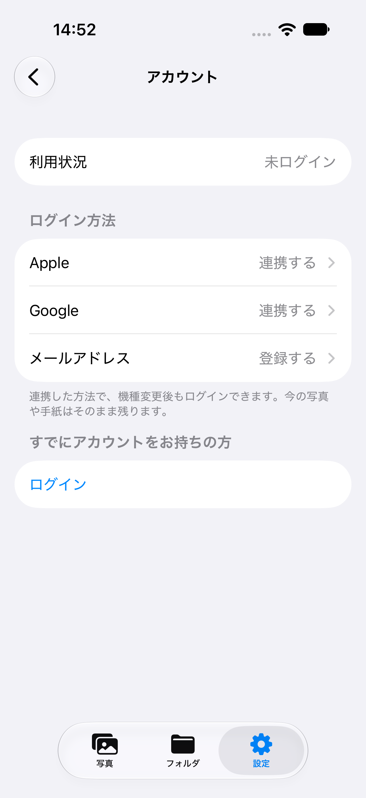
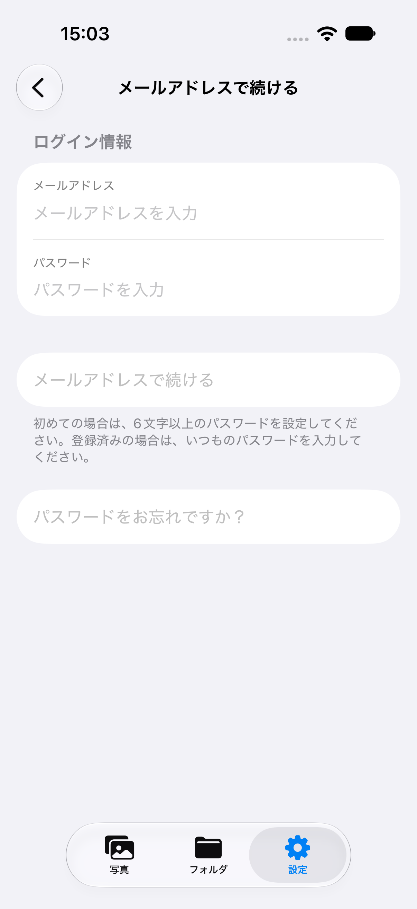
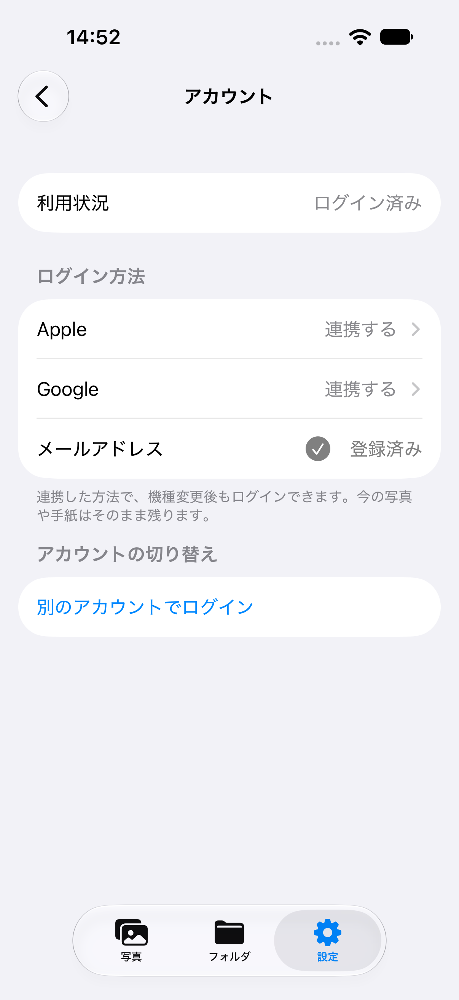
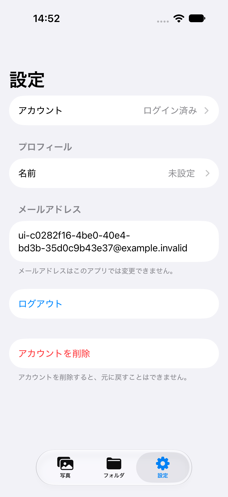
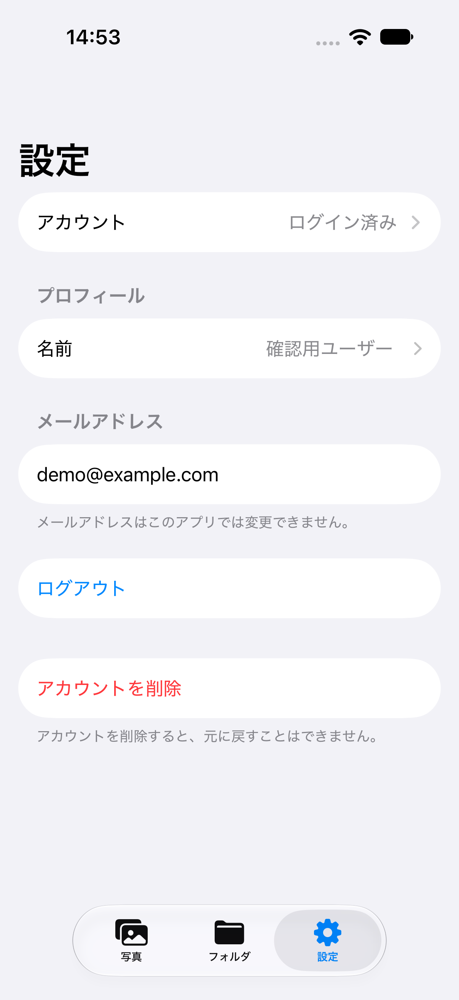
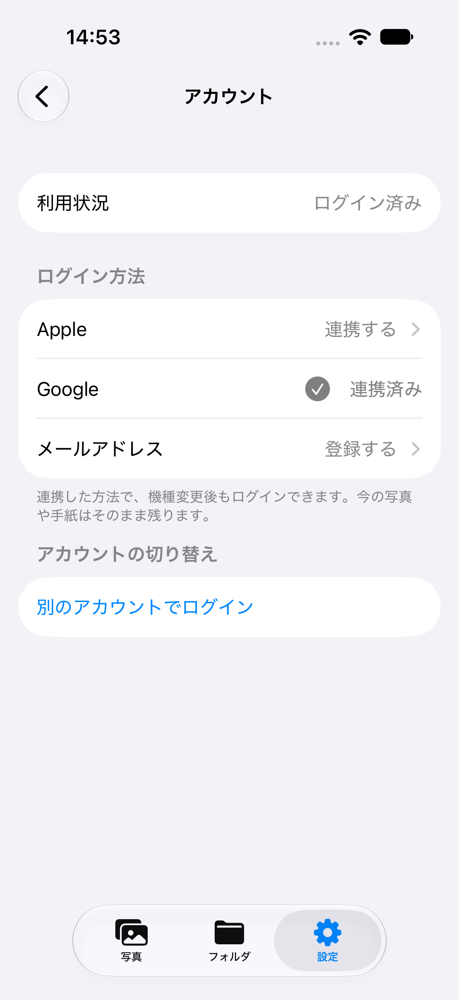

# 匿名ログインとアカウント連携

確認日: 2026-10-11〜12（日本時間）

## 実装

- Firebase が保存済みの認証状態を復元した後、ユーザーが存在しない初回起動だけ匿名ログインします。既存の匿名・Apple・Google・メールユーザーは、その UID を維持します。
- 設定から Apple、Google、メール/パスワードを `User.link(with:)` で現在のアカウントへ追加します。連携済みのユーザーも、未連携の認証方法を追加できます。
- Apple は毎回新しい暗号学的乱数の nonce と標準認証ボタンを使用します。Google のリダイレクトは、既存ログイン画面を一度も開いていない場合も処理します。
- 連携時に別の Firebase アカウントへログインする処理は行いません。登録済みアカウントとの衝突はエラーを表示し、現在の匿名アカウントを保持します。
- 設定 → アカウントの「ログイン」（連携済みの場合は「別のアカウントでログイン」）は明示的な切り替え操作です。匿名時の写真・手紙は自動移行されず、切り替え前に説明と確認を表示します。既存の FirebaseUI ログインを使用します。
- 匿名時はログアウトを表示しません。アカウント削除には対応しています。ログアウト・削除直後はログイン画面を表示し、「登録せずに始める」で匿名利用を再開できます。
- 連携後は空のメールアドレスを補完し、編集済みの名前・既存プロフィール・ライブラリの日付を保持します。
- メール連携はメールアドレスとパスワード1欄を入力します。6文字未満の場合は送信できません。

## 設定UIの整理と文言の調査

- 設定には「アカウント」の1行を置き、専用画面へ遷移します。専用画面に利用状況、Apple・Google・メールの連携状況、既存アカウントへのログインをまとめました。
- 連携方法を選ぶと、さらに各連携画面へ遷移します。標準の戻る操作でアカウント画面へ戻り、連携に成功した場合も同じ画面へ戻って状態を更新します。
- アプリ内の既存の設定・名前編集画面とフォルダ一覧の `NavigationLink` を確認し、標準の `Form` と画面遷移を継承しました。
- 導入済み FirebaseUI の `FirebaseAuthUI/Sources/Strings/ja.lproj/FirebaseAuthUI.strings` を確認。「プロフィール」「メールアドレス」「パスワード」「ログイン」など、既存認証画面の用語を使用しています。
- [LINE公式ヘルプのアカウント連携手順](https://help.line.me/line/smartphone?contentId=20025070&lang=ja)では「設定 → アカウント → 連携する」という構成を確認しました。PicTuneでも入口は「アカウント」、Apple・Googleの操作は「連携する」、状態は「連携済み」としています。
- メールは[同ヘルプのメールアドレス登録](https://help.line.me/line/?contentId=20000060&lang=ja)の表記も確認し、「メールアドレスを登録」「登録する」「登録済み」としています。
- 「今の思い出を引き継ぐ」などの見出しを削除し、連携によって機種変更後もログインできることを短く説明します。利用状況と設定の入口は、匿名時に「未ログイン」、連携後に「ログイン済み」と表示します。内部では匿名認証を使い、写真などを保存できる状態を維持します。
- 既存アカウントへの切り替え時は、現在のデータが引き継がれないことを確認します。名前編集、ログアウト、削除は従来どおり設定画面にあります。
- 匿名時にメールアドレスがない場合は空のメール欄を表示しません。メール入力では項目名を常時表示し、キーボードの「次へ」でパスワード欄、「完了」で入力を終了できます。

## 確認環境

- プロジェクト / スキーム: `PIcTune.xcodeproj` / `PIcTune`
- Xcode: 27.2 Beta 2
- シミュレーター: iPhone 18 Pro / iOS 27.0（端末名 `PicTune Auth Tests`）
- 通常の署名付きビルドを使用。`CODE_SIGNING_ALLOWED=NO` は使用していません。

## 確認済み

- 署名付きビルド成功。
- 最新mainの写真保存修正を取り込んだ状態で、単体・統合テスト32件成功。初回匿名作成、既存ユーザーの復元、UID維持、写真・曲情報・手紙・編集した名前の保持、メール再ログイン、認証方法の衝突、無効なメール・弱いパスワード、Appleキャンセル、セッション切り替え後の古い連携画面の拒否を確認。
- エミュレーター上で Apple / Google のテスト用認証情報を同じ UID に連携し、両方で同じアカウントへ再ログインできることを確認。実際の Apple / Google 認証サーバーへの接続確認ではありません。
- シミュレーターで設定 → アカウント → 各連携画面の遷移と戻る操作、匿名からの既存ログイン画面表示、匿名アカウント削除と再開、既存の名前編集・ログアウト確認画面を確認。
- 10月12日に画面遷移変更後のUIテスト4件が成功しました。メール入力 → 連携 → アプリ再起動によるセッション復元 → ログアウト → FirebaseUIでのメール再ログイン → 設定操作まで確認済みです。32件の単体・統合テストも同日に再実行して成功しています。メールの文言とログイン状態の表示を調整した後も、メール登録・再ログインと既存ユーザー設定のUIテスト2件を再実行し、成功しています。
- UIテスト中にiOSのパスワード保存確認を閉じる操作が一度失敗しました。保存確認の表示元である `SafariViewService` に操作を送るよう修正し、保存せずに閉じて再ログイン後の設定まで操作できることを再確認しました。
- 本番 Firebase の一時アカウントで、REST API による匿名認証 → メール連携 → メール再ログインを確認。同じ UID と匿名時に保存した手紙へのアクセスが維持され、デプロイ済み Firestore ルールで読み書きできました。検証用文書2件とアカウントは削除済みです。

## Firebase 設定

- 対象プロジェクト `sotugyou-7ea16` の `signIn.anonymous.enabled` を `false` から `true` に変更しました。
- Apple・Google・メール認証は既に有効でした。匿名アカウントの自動クリーンアップは無効です。
- 既存ユーザー、他の認証設定、Firestore / Storage ルールは変更していません。

## 再現方法

ローカルの認証・Firestoreエミュレーターを起動します。

```sh
firebase emulators:start --only auth,firestore --project demo-pictune-auth --config firebase/auth-emulators.json
```

`PIcTune` スキームの `AuthRegressionTests`、`AnonymousAuthIntegrationTests`、`sotsugyoTests` と、UIテストの `testAnonymous` で始まる3件を実行します。単体テストのホストは Debug でエミュレーターを使用します。統合テストはエミュレーター未起動時にはスキップします。

画面を手動確認する場合、Debugビルドに `-auth-emulator` を渡すとローカル環境を使用します。さらに `-auth-reset-session` を渡すとローカルのセッションをログアウトして初回起動を再現できます。Releaseビルドではこれらの引数を使用しません。

## 未確認・制約

- Apple / Google の実アカウントでの認証、連携、再ログインと実機での操作は未確認です。
- FirebaseUIによる既存ユーザーの通常ログインは維持しています。匿名データと登録済み別アカウントのデータを統合する機能は含めていません。
- 連携前に端末の認証情報を失うと、匿名アカウントへのログイン手段がありません。
- アカウント削除は既存の Firebase Authentication ユーザー削除処理に匿名対応を加えています。Firestore / Storage のユーザーデータを一括削除する新しい処理は含みません。
- App Storeへの配布は行っていません。

## 画面

すべてローカルエミュレーターまたはプロフィールfixtureの検証用データです。

| 設定の入口 | アカウント | メール連携 |
| --- | --- | --- |
|  |  |  |

| Apple連携 | Google連携 | メール連携後のアカウント |
| --- | --- | --- |
|  |  |  |

| メール連携後の設定 | メール再ログイン後 |
| --- | --- |
|  |  |

既存Googleユーザーの設定表示はローカルのプロフィールfixtureで確認しています。実Googleログインを確認した画像ではありません。






