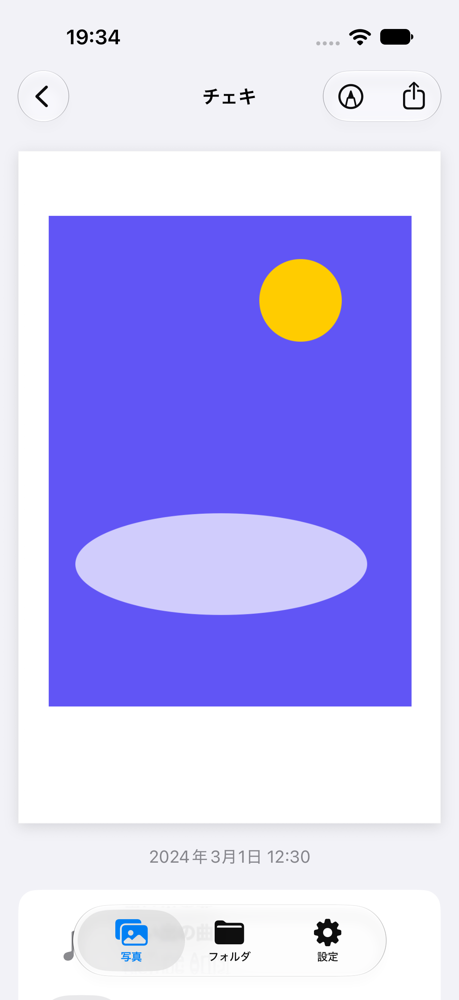
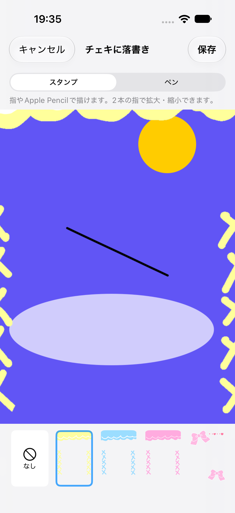
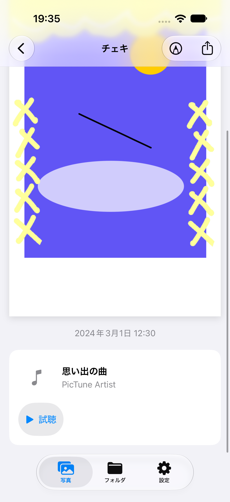
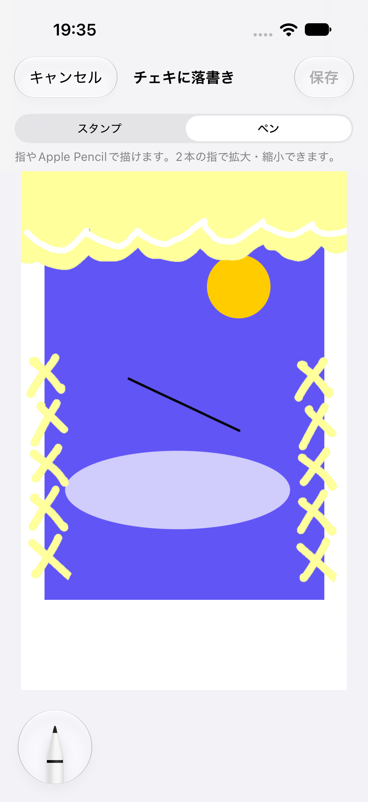
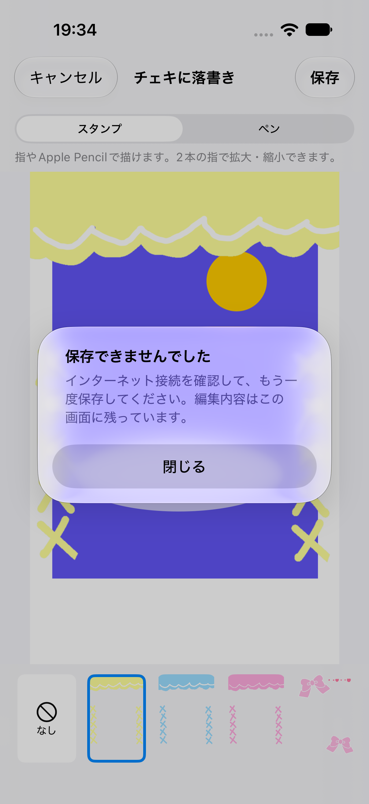

# 保存済みチェキへの落書き

## 変更内容

写真タブ・自分のフォルダでチェキを開き、右上の「落書き」からペンやスタンプを追加して保存します。編集のない状態では保存できません。キャンセル時は今回の編集の破棄を確認し、通信・権限などの保存失敗時は編集画面を維持します。

元画像に描き足すため、保存済みの枠・装飾をそのまま使います。以前に保存した線やスタンプは画像の一部であり、個別の消去・移動には対応していません。今回描いた線はPencilKitの消しゴムで消せます。保存先はアプリ内です。写真ライブラリへの書き出しは、詳細の既存の共有操作から行います。

保存時は新しいJPEGファイル名を発行し、アップロード前に変更できない`imageOwners/{fileName}`を作成します。Storageには`contentType: image/jpeg`と現在のUIDの`ownerIDs`を指定します。その後、自分の各フォルダで元画像ファイル名が同じ写真の`url`だけをFirestoreトランザクションで変更します。写真ID・日付・楽曲・動画・未知のフィールドは保持します。古いコピーの写真IDが異なる場合も対象になります。

編集開始後に写真の変更・削除があった場合は保存を拒否し、削除済み写真を再作成しません。500件を超えるコピーがある場合は、部分更新を避けるため保存前に拒否します。写真タブとフォルダタブの表示・カバーのキャッシュを更新し、ウィジェットも従来の`first`・`second`・`third`形式で更新します。ログアウト後に古い保存処理の結果で画面を復元しません。

QRや旧NFC取り込み先の他ユーザーの写真は変更しません。共有先が引き続き参照できるよう元画像ファイルは削除しません。招待リンクで共有している自分のフォルダでは、既存の購読処理で変更が相手にも反映されます。トランザクション失敗時や応答が不明な場合、新しいアップロード画像も自動削除せず残します。

## Firebaseルールの反映

アプリの公開前に`firebase/firestore.rules`を対象環境へ反映する必要があります。写真の`url`変更は、写真を管理する本人が、所有または共有権限を持つ画像に差し替える場合に許可します。未許可画像への差し替え、受信者による送り主の写真変更は拒否します。Storageルールの変更はありません。

本番環境へのルール反映はこの作業には含めていません。

## 確認環境・結果

### iOS 27.0

2026年10月19日、iPhone 18 Pro / iOS 27.0（24A434）の専用シミュレーター（`PicTune Saved Cheki iOS 27`）で、`PIcTune`スキームの通常の署名付きビルドを使用しました。以下のスクリーンショットも、この端末のDebug限定ローカル固定データで撮影しています。

保存済みチェキの描画・拡大・スタンプ・保存・再編集・フォルダからの再編集と、破棄確認・保存失敗時の編集保持のUIテスト2件が成功しました。曲・撮影日時・共有ボタンの表示も確認しています。

iOS 27の破棄確認はポップオーバーで表示され、「編集を続ける」ボタンが省略されます。テストをその表示に対応させ、ポップオーバーの外側をタップすると確認が閉じ、編集を続けられることを確認しました。アプリ側の保存・描画実装は変更していません。

### iOS 18.5での先行確認

2026年10月19日、iPhone 16 Pro / iOS 18.5 の専用シミュレーター（`PicTune Saved Cheki Review`）で、`PIcTune.xcodeproj`の`PIcTune`スキームを通常の署名付きビルドで確認しました。ビルドにはXcode 27.2を使用しています。表示はDebug限定のローカル固定データです。

- `LibraryRegressionTests` 13件：解像度・縦横比・枠・描画位置・スタンプの合成、写真情報の維持、別タブへの反映、ウィジェット、失敗時の元画像保持、ログアウト後の古い応答、写真読み込みとの競合を含めて成功。
- `RepositoryIntegrationTests` 11件：ローカルFirestore（8089番）で実行し、同一ユーザーのコピー更新、未知のフィールド・曲・日時の維持、他ユーザーの写真の保持、再取得、古い編集の拒否、アップロード失敗・同時削除時の非更新を含めて成功。画像アップロード自体は注入した処理で代替しています。
- Firebaseルール10件：`npm test --prefix firebase`をFirestore（8187番）・Storage（9297番）のローカルエミュレーターで実行し、すべて成功。登録済みの所有画像の作成、編集画像への差し替え、共有先の読み込み、不正な差し替え・他人の写真の編集の拒否、共有フォルダ削除後の拒否を確認しました。
- UIテスト：保存済みチェキの描画・拡大・スタンプ・保存・再編集・フォルダからの再編集と、破棄確認・保存失敗時の編集保持の2件がライト表示で成功しています。同じ2件と、既存の写真一覧・詳細／撮影後編集・音楽検索の計4件も、ダーク表示ですべて成功しました。チェキ下部の余白調整後も、保存・再編集のテストを再実行して成功しました。下部の余白とPencilKitのツールが重ならないことをスクリーンショットで確認しています。

## スクリーンショット

以下はすべてiPhone 18 Pro / iOS 27.0で撮影しています。実際の写真やアカウント情報は使用していません。

| 詳細の落書きボタン | スタンプ | 保存後の曲・日時 |
| --- | --- | --- |
|  |  |  |

| 落書き（保存後の再編集） | 通信失敗時 |
| --- | --- |
|  |  |

## 未確認事項

実機でのApple Pencil・指による描画、実Firebase環境への保存の一連の動作、編集後の写真ライブラリへの書き出し、QR・NFC機器との連携は未確認です。QR受信者を変更しないことはFirestore統合テスト、招待共有先の編集後の画像アクセスはルールテストで確認しており、実機で共有を再現したものではありません。
